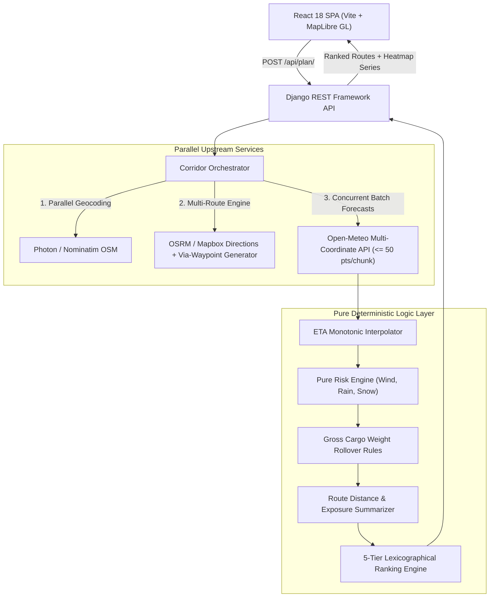

# WATR: Commercial Weather-Aware Truck Routing

[](file:///D:/WATR/backend/planner/tests)
[](file:///D:/WATR/backend)
[](file:///D:/WATR/backend)
[](file:///D:/WATR/frontend)
[](file:///D:/WATR/frontend)
[](file:///D:/WATR/frontend)
[](file:///D:/WATR/docker-compose.yml)
[](file:///D:/WATR/LICENSE)

**WATR (Weather-Aware Truck Routing)** is an enterprise corridor intelligence and safety platform designed for commercial freight dispatchers and long-haul motor carriers. It automatically evaluates multiple alternative highway corridors between any origin and destination, samples physical route checkpoints at uniform intervals (10, 25, or 50 miles), queries high-resolution hourly weather forecasts aligned to the truck's cumulative time-of-arrival (ETA), applies DOT commercial rollover safety rules based on gross cargo load weight, and lexicographically ranks routes to recommend the safest path for commercial fleets.

---

## 🌐 Live Production Deployments

The application is deployed across high-availability cloud infrastructure and is accessible live:

| Service | Platform | Live URL | Endpoint / Health Status |
|---|---|---|---|
| **Frontend Web App** | Vercel (Edge CDN) | [https://watr-spotter-asmt.vercel.app](https://watr-spotter-asmt.vercel.app) | Single-Page Application (SPA) |
| **Backend REST API** | Render (Docker Python 3.12) | [https://watr-spotter-asmt.onrender.com](https://watr-spotter-asmt.onrender.com) | [`GET /api/health/`](https://watr-spotter-asmt.onrender.com/api/health/) (200 OK) |

---

## 📐 High-Level Architecture & Request Pipeline

WATR implements a clean, decoupled architecture. Network I/O, routing services, batch weather queries, and geocoding are managed asynchronously on the backend, while all mathematical operations, ETA interpolation, risk scoring, load weight downgrades, and recommendation rankings are executed as **100% pure deterministic functions** with zero network or database dependencies.



---

## 🗂️ Codebase Architecture & System Overview

Below is the complete structural breakdown of the repository detailing the exact responsibility of every module and file across the stack:

```
WATR/
├── backend/                                 # Django 5 REST Framework service
│   ├── config/                              # Core project configuration
│   │   ├── settings.py                      # Environment-driven settings (WhiteNoise, CORS, Redis cache)
│   │   ├── urls.py                          # Top-level URL routing (/api/...)
│   │   ├── wsgi.py                          # Production WSGI application for Gunicorn
│   │   └── asgi.py                          # ASGI entrypoint
│   ├── planner/                             # Core routing & weather planning application
│   │   ├── views.py                         # Thin REST controllers (PlanTripView, GeocodeView, HealthCheckView)
│   │   ├── serializers.py                   # Strict request validation (weights, bounds) & response typing
│   │   ├── urls.py                          # Application endpoints (/api/plan/, /api/geocode/, /api/health/)
│   │   ├── services/                        # External provider integrations behind unified interfaces
│   │   │   ├── geocoding.py                 # Photon primary, Nominatim fallback, in-memory/Redis caching
│   │   │   ├── routing.py                   # OSRM + Mapbox client + via-waypoint offset alternative generator
│   │   │   ├── weather.py                   # Open-Meteo batch client (<=50 pts/chunk, ThreadPoolExecutor, retry backoff)
│   │   │   └── orchestrator.py              # Parallel multi-route coordinator, ETA matching & heatmap matrix builder
│   │   ├── logic/                           # 100% PURE FUNCTIONS (zero network I/O, completely deterministic)
│   │   │   ├── risk.py                      # Sustained wind, rain, snow classification & gross load rollover rules
│   │   │   ├── geometry.py                  # Haversine distance, uniform checkpoint sampling & RDP polyline simplification
│   │   │   ├── eta.py                       # Monotonic time interpolation across cumulative route mileage
│   │   │   ├── summary.py                   # Midpoint segment allocation, per-level miles & distance-weighted average risk
│   │   │   └── recommend.py                 # 5-tier ascending lexicographical ranking & comparative reason generator
│   │   └── tests/                           # Unit & integration test suite (113 tests, 94%+ coverage)
│   │       ├── test_risk.py                 # 42 boundary tests for wind, rain, snow, and gross cargo weight
│   │       ├── test_geometry.py             # Haversine, sampling intervals, and RDP decimation verification
│   │       ├── test_eta.py                  # Monotonic progression and time-zone boundary tests
│   │       ├── test_summary.py              # Segment conservation (sum == total) and average risk scoring
│   │       ├── test_recommend.py            # Lexicographical sort hierarchy and comparative reasoning tests
│   │       ├── test_weather.py              # Chunking, concurrent ThreadPool, and fallback handling
│   │       ├── test_routing.py              # Multi-route extraction and via-waypoint alternative generation
│   │       ├── test_geocoding.py            # Photon to Nominatim fallback and result caching
│   │       ├── test_orchestrator.py         # Full end-to-end trip planning workflow contract tests
│   │       └── fixtures/                    # Raw upstream provider payloads from live spike tests
│   ├── Dockerfile                           # Production Python 3.12-slim image with WhiteNoise & Gunicorn
│   └── requirements.txt                     # Pinned backend dependencies
│
├── frontend/                                # Modern React 18 SPA built with Vite
│   ├── public/
│   │   ├── maplibre-gl-worker.mjs           # Bundled MapLibre Web Worker for GPU vector rendering
│   │   └── favicon.svg                      # Custom vector truck & storm brand icon
│   ├── src/
│   │   ├── main.jsx                         # React entrypoint mounting Emotion/MUI Theme & React Query
│   │   ├── App.jsx                          # App container rendering the Planner view
│   │   ├── pages/
│   │   │   └── Planner.jsx                  # Main orchestrator syncing TripForm, RouteMap, Drawer & Cards
│   │   ├── components/                      # Modular UI component hierarchy
│   │   │   ├── AppHeader.jsx                # Top app bar with live status indicator and free-tier wake-up chip
│   │   │   ├── ShellLayout.jsx              # Responsive 3-panel desktop layout + fluid mobile drawer switcher
│   │   │   ├── TripForm.jsx                 # Trip inputs: debounced origin/destination, weight slider, example trip
│   │   │   ├── LocationAutocomplete.jsx     # Real-time debounced geocoding search field with loading indicators
│   │   │   ├── RouteCard.jsx                # Route summary card displaying miles, duration, risk stats & "Why this route"
│   │   │   ├── RouteComparison.jsx          # Direct trade-off comparison between fastest and recommended routes
│   │   │   ├── RouteCardSkeleton.jsx        # Zero-CLS placeholder skeletons during route evaluation
│   │   │   ├── RouteMap.jsx                 # GPU-accelerated MapLibre dark canvas with route shaders & white checkpoint dots
│   │   │   ├── HeatmapSlider.jsx            # 0–48h timeline forecast scrubber with play/pause and milestone chips
│   │   │   ├── CheckpointTable.jsx          # Sortable table of checkpoints with weather badges & map centering buttons
│   │   │   ├── RiskStrip.jsx                # Distance-proportional color strip visualizer representing route exposure
│   │   │   └── RiskBadge.jsx                # Standardized risk chip with matching background, text, and alert icon
│   │   ├── api/                             # Data layer & API communications
│   │   │   ├── client.js                    # Fetch wrapper with typed error mapping (422, 502, 504)
│   │   │   ├── queries.js                   # TanStack React Query hooks (usePlanTrip, useGeocode, useHealthCheck)
│   │   │   ├── types.js                     # JSDoc contracts matching backend API schemas
│   │   │   └── fixtures/plan.json           # Offline fallback mock dataset
│   │   ├── lib/                             # Utility helpers & configuration
│   │   │   ├── risk.js                      # Risk palette colors, severity weights, and icon constants
│   │   │   ├── formatters.js                # Human-friendly formatters for miles, hours, wind, rain, and snow
│   │   │   └── useDebounce.js               # 350ms input debounce hook for geocoding queries
│   │   └── theme/
│   │       └── theme.js                     # MUI v5 dark palette, 8px spacing scale, and accessible focus styles
│   ├── Dockerfile                           # Multi-stage build (Node 20 Vite -> Nginx Alpine with SPA routing)
│   ├── nginx.conf                           # Nginx configuration with gzip compression and cache headers
│   └── package.json                         # Frontend dependencies and build scripts
│
├── docker-compose.yml                       # Unified 1-command local orchestration (Backend, Frontend, Redis)
└── README.md                                # Project documentation, architecture, and developer guide
```

---

## 🔌 APIs, Upstream Providers & Technology Stack

WATR integrates industry-leading open APIs for cartography, routing, geocoding, and meteorology:

### 1. External APIs & Providers

| Capability | Provider | Fallback / Redundancy | Details & Implementation |
|---|---|---|---|
| **Geocoding & Autocomplete** | **Photon (Komoot OSM)** | **Nominatim (OpenStreetMap)** | Fast, unstructured OSM query search with 350ms frontend debounce and server-side local cache. Automatically falls back to Nominatim if Photon rate limits. |
| **Routing & Corridor Geometry** | **OSRM Public API** | **Mapbox Directions API** | High-precision road network solver. When upstream engines return only 2 paths, WATR activates its **perpendicular via-waypoint offset generator** to produce a 3rd distinct alternative corridor (>90% geometry overlap de-duplication). |
| **Weather Forecasts** | **Open-Meteo Multi-Coordinate API** | In-Memory / Redis Caching | Multi-point batch hourly weather ($v_{\text{wind}}$ in mph, precipitation in in/hr, snowfall in in/hr). Checkpoints chunked into batches of $\le 50$ coordinates executed in parallel via `concurrent.futures.ThreadPoolExecutor`. |
| **Basemap & Vector Canvas** | **Esri Dark Gray Canvas** | Standard OpenStreetMap | 100% free, high-contrast, zero-API-key dark canvas raster tiles (`World_Dark_Gray_Base` & `World_Dark_Gray_Reference`), eliminating third-party tile quota exhaustion. |

### 2. Comprehensive Technology Matrix

- **Backend Framework**: Python 3.12, Django 5.0, Django REST Framework, Gunicorn WSGI.
- **Static Assets & Caching**: WhiteNoise (gzip/brotli asset serving), Redis 7 (optional cache layer) / Django LocMemCache.
- **Frontend Core**: React 18.3, Vite 5, TanStack React Query v5.
- **UI & Design System**: Material UI v5 (MUI), Emotion React/Styled, Dayjs date handling.
- **Map & Geospatial Visualizer**: MapLibre GL v5, React-Map-GL, custom WebGL line and circle shaders, dedicated Web Worker (`maplibre-gl-worker.mjs`).
- **Containerization & CI/CD**: Docker multi-stage builds, Docker Compose, Nginx Alpine, GitHub Actions, Vercel Edge, Render PaaS.

---

## 🛡️ Core Risk Engine & Rollover Safety Rules

WATR classifies each sampled route checkpoint into one of 5 risk tiers based on sustained wind, precipitation rate, and snowfall accumulation.

### 1. Weather Hazard Thresholds

| Risk Level | Color Code | Sustained Wind (`wind_mph`) | Rain Accumulation (`rain_in_hr`) | Snowfall Rate (`snow_in_hr`) |
|:---|:---:|:---:|:---:|:---:|
| **1 - Low** | 🟢 Green | $0 \le v < 25\text{ mph}$ | $0.00 \le v < 0.10\text{ in/hr}$ | $0.00 \le v < 0.50\text{ in/hr}$ |
| **2 - Moderate** | 🟡 Yellow | $25 \le v < 35\text{ mph}$ | $0.10 \le v \le 0.25\text{ in/hr}$ | $0.50 \le v \le 1.00\text{ in/hr}$ |
| **3 - High** | 🟠 Orange | $35 \le v < 45\text{ mph}$ | $0.25 < v \le 0.50\text{ in/hr}$ | $1.00 < v \le 2.00\text{ in/hr}$ |
| **4 - Severe** | 🔴 Red | $45 \le v < 55\text{ mph}$ | $0.50 < v \le 1.00\text{ in/hr}$ | $2.00 < v \le 3.00\text{ in/hr}$ |
| **5 - No Travel** | 🟣 Purple | $v \ge 55\text{ mph}$ | $v > 1.00\text{ in/hr}$ | $v > 3.00\text{ in/hr}$ |

### 2. Commercial Vehicle Weight Downgrades
Empty and lightweight commercial trailers are highly susceptible to high crosswind rollovers. WATR enforces strict load-based elevation rules:

- **Heavy / Loaded Trailers ($> 40,000\text{ lbs}$)**: Evaluated at standard wind thresholds.
- **Light Trailers ($\le 40,000\text{ lbs}$)**: Any sustained wind in the High band ($35 \le v < 45\text{ mph}$) is automatically elevated to **Severe (Level 4)**.
- **Empty / Bobtail Trailers ($\le 30,000\text{ lbs}$)**: Any sustained wind in the Severe band ($45 \le v < 55\text{ mph}$) is automatically elevated to **No Travel (Level 5)**.
- **Monotonic Safety Invariant**: Load rules **can only raise risk**, never lower it.

---

## 🏆 Recommendation Engine: 5-Tier Lexicographical Ranking

WATR avoids arbitrary weighted formulas by utilizing a strict deterministic sorting key:

$$\text{SortKey} = (\text{NoTravelMiles},\ \text{SevereMiles},\ \text{HighMiles},\ \text{AvgRiskScore},\ \text{DurationMinutes})$$

1. **Tier 1 (Safety Paramount)**: Lowest exposure miles in **No Travel (Level 5)**.
2. **Tier 2 (Severe Mitigation)**: Lowest exposure miles in **Severe (Level 4)**.
3. **Tier 3 (High Mitigation)**: Lowest exposure miles in **High (Level 3)**.
4. **Tier 4 (Distance-Weighted Risk)**: Lowest continuous average risk score across the trip:
   $$\bar{R} = \frac{\sum (R_i \times d_i)}{\sum d_i}$$
5. **Tier 5 (Efficiency)**: Shortest duration in minutes.

### Hard Safety Guarantee
- If a route encounters any **No Travel** conditions ($\text{NoTravelMiles} > 0$), it is disqualified from being recommended (`is_recommended: false`).
- If all candidate routes encounter **No Travel**, the engine marks all routes unrecommended and raises an explicit corridor hazard warning.

---

## 💻 Interactive Web Application Features

1. **Auto-Complete Geocoding**: Real-time address lookups powered by Photon/Nominatim with local caching and 350ms debounce.
2. **Route Visualizer**: MapLibre GL dark-gray canvas featuring WebGL line shaders with per-segment risk coloring and pure white checkpoint markers with risk halos.
3. **0–48 Hour Dynamic Forecast Heatmap**: Pre-calculated corridor weather matrix allows dispatchers to scrub forward in time to anticipate approaching storm fronts without making additional network calls.
4. **Interactive Checkpoint Table**: Sortable, filterable table detailing cumulative miles, truck ETA, primary/secondary weather drivers, and load elevation tags. Clicking any row pans and zooms the map directly to that coordinate.

---

## ⚡ Quickstart: Local Setup

### Option A: 1-Command Docker Compose (Recommended)
```bash
git clone https://github.com/aftab707/WATR-Spotter-asmt.git
cd WATR
docker compose up --build
```
- Frontend: `http://localhost:5173`
- Backend API: `http://localhost:8000/api/health/`

---

### Option B: Native 5-Command Local Run

#### 1. Backend Setup (Terminal 1)
```bash
cd backend
python -m venv .venv
# Windows: .venv\Scripts\activate | Unix: source .venv/bin/activate
pip install -r requirements.txt
python manage.py runserver 8000
```

#### 2. Frontend Setup (Terminal 2)
```bash
cd frontend
npm install
npm run dev
```
Open [http://localhost:5173](http://localhost:5173) in your browser.

---

## 📡 API Specification & Sample Payload

### `POST /api/plan/`
Plans a multi-route trip, sampling corridor weather and returning ranked recommendations.

#### Sample Request:
```json
{
  "origin": "Chicago, IL",
  "destination": "Denver, CO",
  "departure_time": "2026-10-24T08:00:00Z",
  "load_weight_lb": 32000,
  "checkpoint_interval_miles": 25
}
```

#### Sample Response (Truncated):
```json
{
  "recommended_route_id": "route_1",
  "routes": [
    {
      "id": "route_1",
      "label": "I-80 W (via Des Moines)",
      "rank": 1,
      "is_recommended": true,
      "recommendation_reason": "Recommended: Avoids 48.5 mi of Severe weather vs fastest route.",
      "distance_miles": 1005.1,
      "duration_minutes": 985.0,
      "summary": {
        "avg_risk": 1.42,
        "miles_by_risk": {
          "low": 850.1,
          "moderate": 155.0,
          "high": 0.0,
          "severe": 0.0,
          "no_travel": 0.0
        }
      },
      "geometry": {
        "type": "LineString",
        "coordinates": [[-87.6298, 41.8781], [-88.1023, 41.8542]]
      },
      "checkpoints": [
        {
          "id": "cp_0",
          "mile": 0.0,
          "lat": 41.8781,
          "lon": -87.6298,
          "eta": "2026-10-24T08:00:00Z",
          "risk": 1,
          "risk_label": "LOW",
          "wind_mph": 12.4,
          "rain_in_hr": 0.0,
          "snow_in_hr": 0.0,
          "drivers": [],
          "load_rule_applied": false
        }
      ]
    }
  ]
}
```

---

## 🧪 Test Suite & Code Quality

WATR maintains strict code quality and test discipline:

```bash
# Backend unit & integration test suite (113 passing tests)
backend/.venv/Scripts/pytest backend -v

# Frontend linting (ESLint + strict rules)
cd frontend && npm run lint

# Frontend production bundle build
cd frontend && npm run build
```

---

## 📄 License
MIT License. Commercial use permitted.
